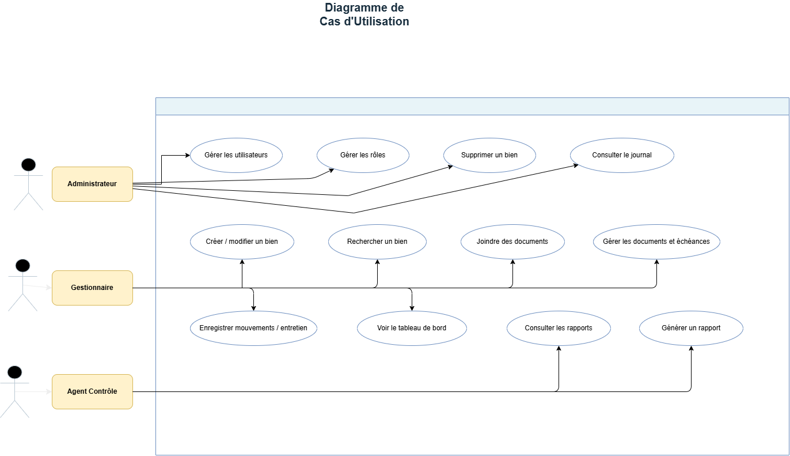
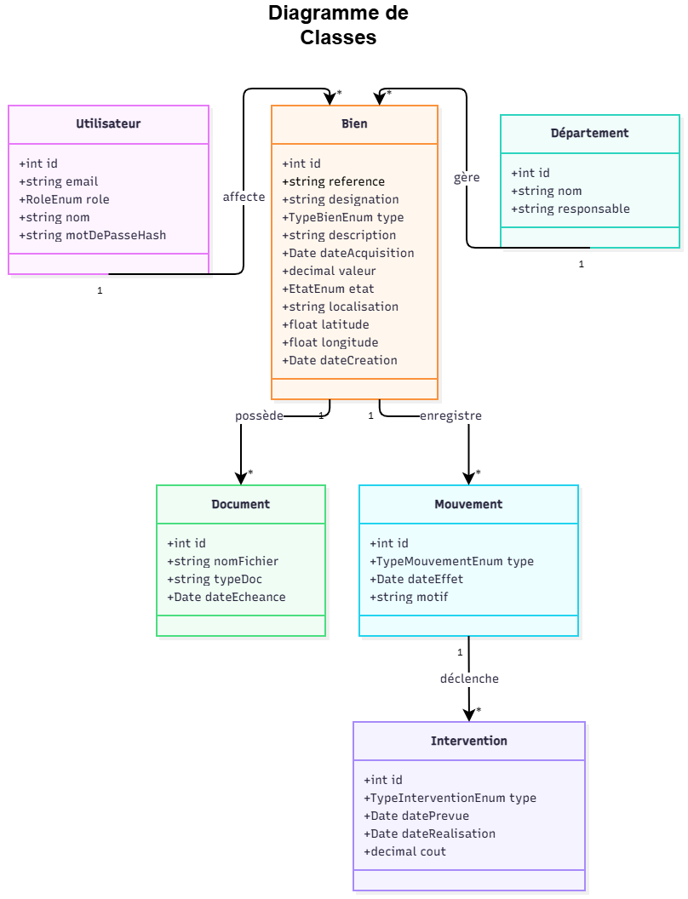
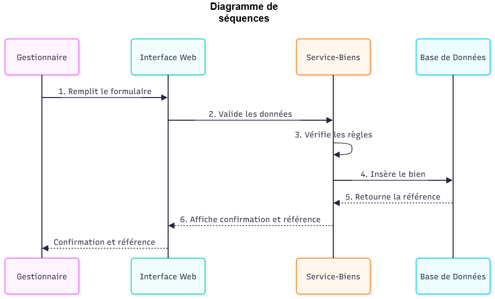
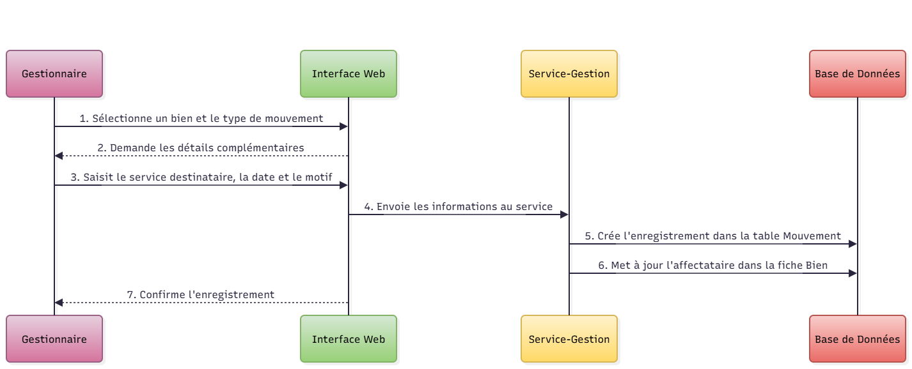
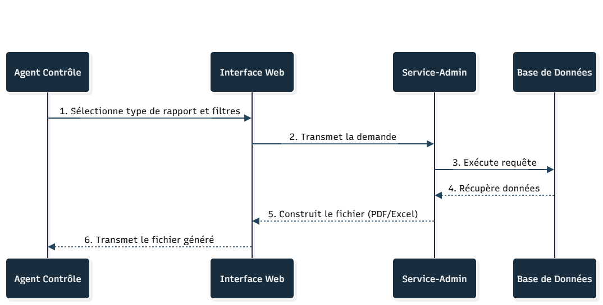
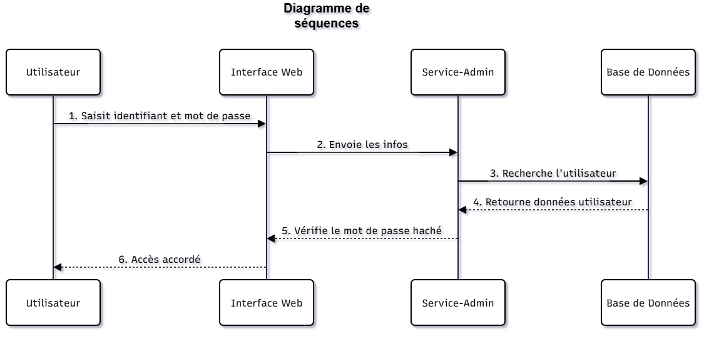
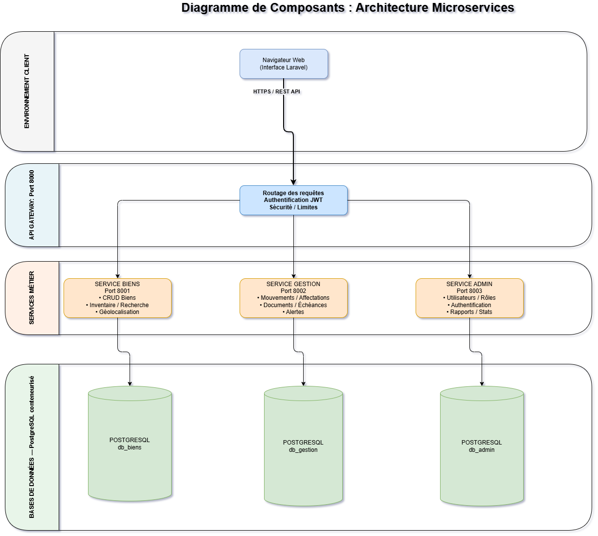
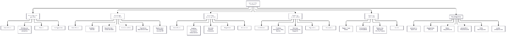

# Conception et modélisation UML de gestion du patrimoine d’État

**Sommaire**

1.  **Diagramme de cas d’Utilisation**

2.  **Diagramme de classes**

3.  **Diagramme de séquence**

4.  **Diagramme de composants**

5.  **Diagramme de Paquetages**

## 1. Diagramme de Cas d’Utilisation



**Description détaillée des cas d'utilisation**

| **Cas d'utilisation**                | **Acteur**             | **Description**                                                      | **Préconditions**                                             | **Postconditions**                                                          |
|--------------------------------------|------------------------|----------------------------------------------------------------------|---------------------------------------------------------------|-----------------------------------------------------------------------------|
| **Créer une fiche de bien**          | Gestionnaire           | Saisir les informations d'un nouveau bien dans l'inventaire          | Être connecté et avoir le droit de création                   | Le bien est enregistré dans la base, une référence unique est générée       |
| **Modifier une fiche de bien**       | Gestionnaire           | Corriger ou compléter les informations d'un bien existant            | Le bien existe dans l'inventaire ; l'utilisateur a les droits | Les informations sont mises à jour ; la date de modification est actualisée |
| **Rechercher un bien**               | Tous                   | Trouver un bien par référence, nom, type ou localisation             | Aucune                                                        | La liste des biens correspondant aux critères est affichée                  |
| **Supprimer une fiche de bien**      | Administrateur         | Retirer définitivement un bien du système avec motif                 | Le bien existe ; l'administrateur confirme la suppression     | Le bien est marqué comme supprimé ; l'action est consignée dans le journal  |
| **Enregistrer un mouvement**         | Gestionnaire           | Enregistrer un changement d'affectation ou de localisation d'un bien | Le bien existe                                                | Le mouvement est enregistré avec date, motif et utilisateur                 |
| **Gérer documents et échéances**     | Gestionnaire           | Attacher des documents à un bien et saisir leurs dates d'échéance    | Le bien existe                                                | Le document est lié au bien ; une alerte est programmée pour l'échéance     |
| **Gérer utilisateurs et rôles**      | Administrateur         | Créer, modifier ou désactiver des comptes et définir leurs droits    | Être administrateur                                           | Le compte est créé/désactivé ; ses permissions sont enregistrées            |
| **Consulter le journal des actions** | Administrateur         | Voir l'historique complet des opérations effectuées dans le système  | Être administrateur                                           | La liste chronologique des actions est affichée                             |
| **Générer des rapports**             | Agent Contrôle / Admin | Exporter des données sous forme de rapport (PDF/Excel)               | Au moins un bien existe dans l'inventaire                     | Le fichier du rapport est généré et téléchargeable                          |
| **Consulter le tableau de bord**     | Tous                   | Voir les statistiques générales du patrimoine                        | Être connecté                                                 | Les indicateurs clés sont affichés                                          |

**2. Diagramme de Classes**



**Description détaillée des classes**

**Classe : Utilisateur**

| **Attribute**  | **Type**    | **Règles**                               |
|----------------|-------------|------------------------------------------|
| id             | Entier      | Clé primaire, auto-incrément             |
| nom            | Texte       | Obligatoire                              |
| prenom         | Texte       | Obligatoire                              |
| email          | Texte       | Unique, obligatoire                      |
| role           | Énumération | ADMIN, GESTIONNAIRE, CONTROLEUR, LECTEUR |
| motDePasseHash | Texte       | Stocké haché, jamais en clair            |
| estActif       | Booléen     | true par défaut                          |

**Classe : Département**

| **Attribute** | **Type** | **Règles**                        |
|---------------|----------|-----------------------------------|
| id            | Entier   | Clé primaire                      |
| nom           | Texte    | Obligatoire                       |
| responsable   | Texte    | Nom du responsable du département |
| description   | Texte    | Optionnelle                       |

**Classe : Bien**

| **Attribut**    | **Type**    | **Règles**                                |
|-----------------|-------------|-------------------------------------------|
| id              | Entier      | Clé primaire                              |
| reference       | Texte       | Unique, généré automatiquement            |
| designation     | Texte       | Obligatoire                               |
| type            | Énumération | IMMOBILIER, MOBILIER, FINANCIER, CULTUREL |
| description     | Texte       | Optionnelle                               |
| dateAcquisition | Date        | Obligatoire                               |
| valeur          | Décimal     | ≥ 0                                       |
| etat            | Énumération | NEUF, BON, MOYEN, DEGRADE, REFORME        |
| localisation    | Texte       | Adresse complète                          |
| latitude        | Décimal     | Optionnel (pour immobiliers)              |
| longitude       | Décimal     | Optionnel (pour immobiliers)              |
| dateCreation    | Date        | Automatique                               |
| dateMiseAJour   | Date        | Automatique                               |

**Classe : Document**

| **Attribute**  | **Type** | **Règles**                           |
|----------------|----------|--------------------------------------|
| id             | Entier   | Clé primaire                         |
| bienId         | Entier   | Clé étrangère vers Bien              |
| nomFichier     | Texte    | Nom tel qu'uploadé                   |
| cheminStockage | Texte    | Chemin sur le serveur                |
| typeDocument   | Texte    | Titre foncier, bail, contrat, photo… |
| dateEcheance   | Date     | Peut être vide                       |
| dateAjout      | Date     | Automatique                          |

**Classe : Mouvement**

| **Attribut**       | **Type**    | **Règles**                                  |
|--------------------|-------------|---------------------------------------------|
| id                 | Entier      | Clé primaire                                |
| bienId             | Entier      | Clé étrangère vers Bien                     |
| utilisateurId      | Entier      | Clé étrangère vers Utilisateur              |
| type               | Énumération | AFFECTATION, RETOUR, PRET, CESSION, REFORME |
| serviceDestination | Texte       | Nom du département/service                  |
| dateEffet          | Date        | Date du changement                          |
| motif              | Texte       | Justification                               |

**Classe : Intervention**

| **Attribut**    | **Type**    | **Règles**                         |
|-----------------|-------------|------------------------------------|
| id              | Entier      | Clé primaire                       |
| bienId          | Entier      | Clé étrangère vers Bien            |
| type            | Énumération | ENTRETIEN, REPARATION, CONTROLE    |
| datePrevue      | Date        | Date initialement prévue           |
| dateRealisation | Date        | Peut être vide si pas encore faite |
| prestataire     | Texte       | Nom de l'entreprise ou personne    |
| cout            | Décimal     | ≥ 0                                |
| commentaire     | Texte       | Observations                       |

**3. Diagrammes de Séquence**

**Séquence 1: Création d’un Bien**



**Description détaillées de la séquence**

1.  Le gestionnaire saisit toutes les informations du bien dans le formulaire web

2.  L'interface vérifie que les champs obligatoires sont remplis

3.  Les données sont envoyées au service backend

4.  Le service vérifie que la référence est unique et valide

5.  Le bien est enregistré dans la base de données

6.  La réponse avec la référence unique est renvoyée et affichée à l'utilisateur

**Séquence 2 : Enregistrement d'un mouvement**



**Séquence 3 : Génération d'un rapport**



**Diagramme de Séquence 4 : Authentification**



**4. Diagramme de Composants : Architecture Microservices**

Ce diagramme montre comment le système est organisé en services indépendants et comment ils communiquent entre eux.



**Description**

- Chaque microservice est **indépendant** : il peut être développé, déployé et mis à jour séparément

- Chaque service possède sa propre base de données PostgreSQL : pas de partage direct

- **L'API Gateway** est le seul point d'entrée depuis l'extérieur : elle achemine chaque demande vers le bon service

- La communication entre services se fait via **API REST** (JSON sur HTTP)

**5. Diagramme de Paquetages**



```text
sgpe-gestion-patrimoine/
│
├── ─ paquetage api-gateway
│ ├── Contrôleurs
│ ├── Middleware (Authentification, Validation)
│ ├── Routes
│ └── Configuration
│
├── ── paquetage service-biens
│ ├── Contrôleurs
│ ├── Modèles / Entités
│ ├── Repositories / Accès données
│ ├── Services (Métier)
│ ├── Migrations (Base de données)
│ └── Ressources / Formatage réponse API
│
├── ── paquetage service-gestion
│ ├── Contrôleurs
│ ├── Modèles (Mouvement, Document, Intervention)
│ ├── Services (Alertes, Échéances)
│ ├── Migrations
│ └── Ressources
│
├── ── paquetage service-admin
│ ├── Contrôleurs
│ ├── Modèles (Utilisateur, Rôle, Journal)
│ ├── Services (Authentification, Rapports)
│ ├── Migrations
│ └── Ressources
│
├── ── paquetage client-web
│ ├── Pages / Vues (Blade)
│ ├── Composants réutilisables
│ ├── Ressources statiques (CSS, JS, Images)
│ └── Assets
│
└── ── paquetage docs
├── analyse-du-besoin.md
├── diagrammes-UML.md
├── figma-maquettes.md
├── proposition-financière.md
├── fiche-technique.md
└── guide-utilisation.md
```
